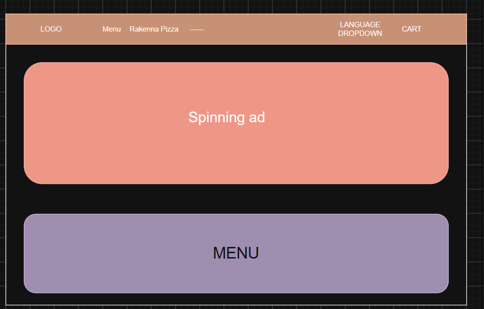

# LlapiPizzeria

Tuntikirjanpito – Pizzeria Llapi
Syyskuu

26.09.2026 – Kävin paikan päällä Pizzeria Llapissa, ja kävin keskustelua asiakkaan kanssa noin 2 tuntia. Kävimme läpi mitä toimintoja nettisivu tarvitsee ja puhuimme teemasta jne. (2h)

27.09.2026 – Tein GitHub repositoryn, ja kävin hieman läpi mitä koodauskieliä voisin käyttää (1h)

15.10.2026 - Valitsin Next.js, jouduin käymään next.js dokumentaatiota miten se toimii ja miten aloitetaan projekti, kesti noin 2h.
Etusivun suunnitteluun meni noin 1h, tämä ei ole lopullinen versio.  
Rakennettiin myös projektinäkymä joka tarvitaan nyt alkuun eli page.tsx (etusivu (menu)), cart-page.tsx, checkout-page.tsx, order-confirmation-page.tsx, kesti noin 30min. (koko päivä 3.5h)

16.10.2026 - Rakennettiin navigointi, joka näkyy aina nettisivussa, ei väliä missä sivussa ollaan. Teema voi vielä vaihtua. Lisäsin myös vaihtoehdon vaihtaa sivuston kieltä, koska asiakas sanoi, että asiakkaat ovat aika paljon 50/50 suomenkielen puhujia ja albaniankielen puhujia. Joudin käymään dokumentaatiota läpi kieli valinnan toiminnoista. (5h)

17.10.2026-18.10.2026 - Etusivuun lisäsin pyörivän mainoksen, eli kun tutkin muita sivuja, monessa oli mainos edessä. Mainos ei ole vielä valmiina kokonaan, joudun lisäämään kuvia ja navigaatiota kun asiakas klikkaa mainokseen. Ensimmäistä kertaa teen tällaisen toiminnon, joten jouduin opiskella miten tehdään tämä. Lisäsin myös menu otsikon ja ruoka kategoriat, jotka näyttävät esimerkiksi pizzat, kun klikataan pizza otsikko. Ei vielä tuotteita. (8h)

27.10-02.11- Lisäsin pop sivun pizzan rakentamiseen, missä käyttäjä pääsee valitsemaan itselleen maksimissaan 3 täyttettä. Tässä on vielä paljon parannettavaa. Hinnat ja tuotteet eivät ole vielä oikeat, tulossa tapaaminen asiakkaan kanssa tällä viikolla. Täysin uusi asia minulle, meni yllättävän paljon aikaa rakentamiseen. (20h)

03.11 - Lisäsin Footerin, eli sivun loppuun tietoja sijainnista, yhteystiedo jne. Jouduin tekemään sivusta vielä puhelinkäyttäjälle toimivan. Tiedot eivät ole oikein tällä hetkellä, käyn läpi asiakkaan kanssa ja päivitän myöhemmin. (3h)

# LOPULLINEN LASKENTA
2h+1h+3.5h+5h+8h+20h+3h
